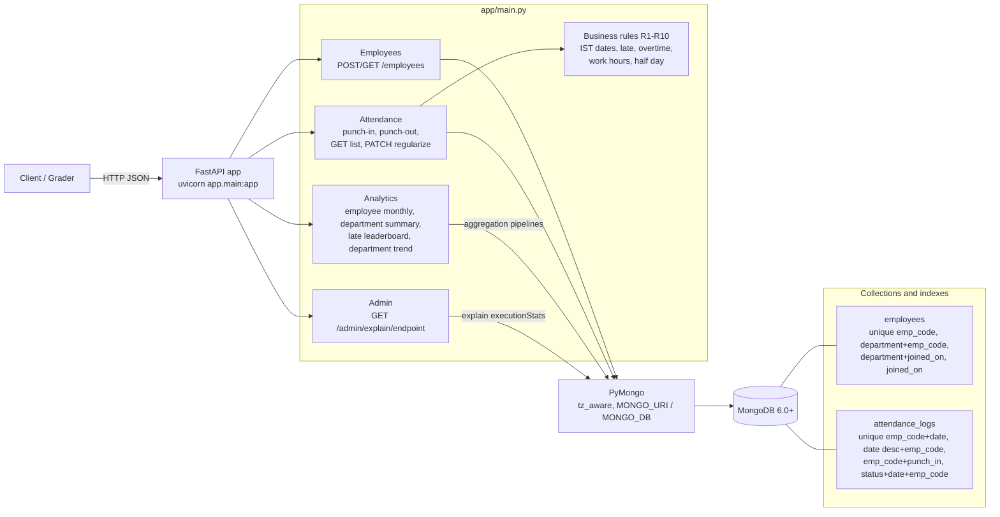

# Employee Attendance & Analytics API

FastAPI + MongoDB (6.0+). All 12 endpoints in `openapi.yaml` are implemented in `app/main.py`.

## System Design



## Run

```bash
python -m venv .venv && source .venv/bin/activate   # Windows: .venv\Scripts\activate
pip install -r requirements.txt
export MONGO_URI="mongodb://localhost:27017"        # or put MONGO_URI / MONGO_DB in a local .env
export MONGO_DB="attendance_db"
uvicorn app.main:app --port 8000
```
# Ambiguity

The contract is ambiguous on moving_avg_7d: R8 rounds only “reported numbers” (so I average unrounded daily rates and round once at the end), but the rule also says “mean of attendance_rate values”, which could mean the already-rounded 4-decimal values. 

Example: headcount 3, present 0 and 2 → unrounded average = 0.3333, average of rounded rates (0.0000, 0.6667) = 0.3334. I chose unrounded to avoid compounding rounding error, and it’s a one-line change if rounded is intended.