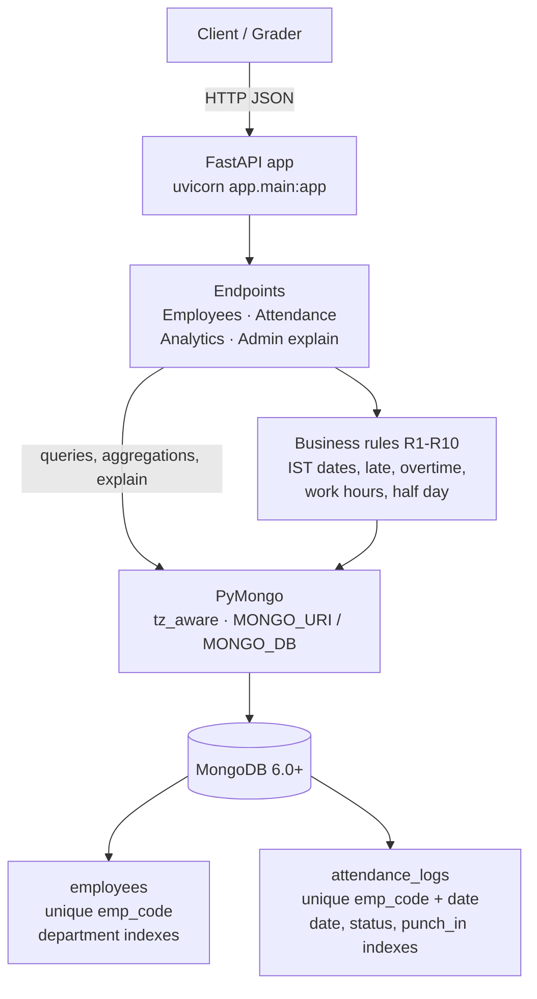

# Employee Attendance & Analytics API

FastAPI + MongoDB (6.0+). All 12 endpoints in `openapi.yaml` are implemented in `app/main.py`.

## System Design



## Run

```bash
python -m venv .venv && source .venv/bin/activate   # Windows: .venv\Scripts\activate
pip install -r requirements.txt
export MONGO_URI="mongodb://localhost:27017"        # or put MONGO_URI / MONGO_DB in a local .env
export MONGO_DB="attendance_db"
uvicorn app.main:app --port 8000
```